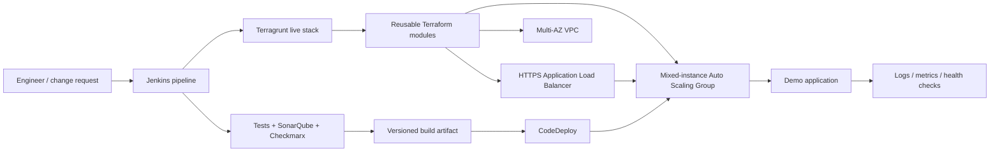
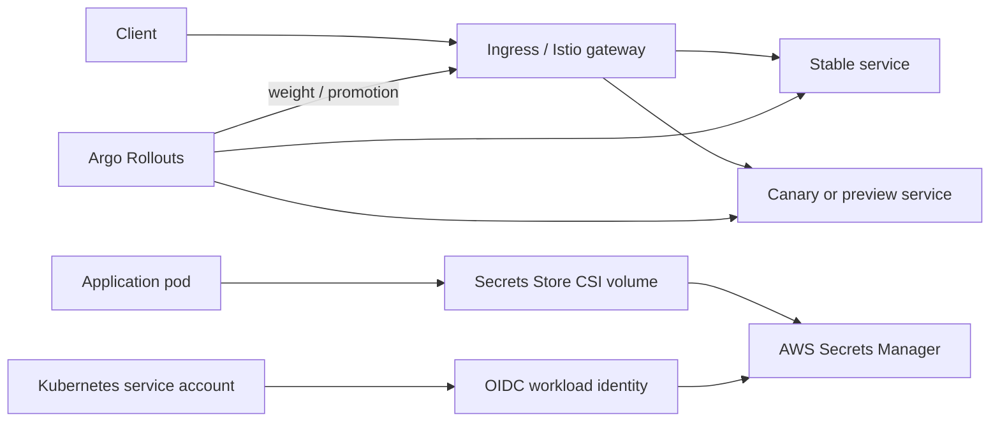
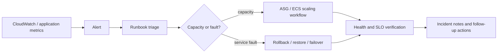

# Recreated Platform Architecture

These diagrams are new, generalized views recreated from the workstreams represented in this repository. They do not reproduce internal network layouts, account boundaries, DNS zones, or customer architecture.

## Infrastructure delivery path

## EKS progressive delivery and workload secrets

The three-farm 98/1/1 Istio experiment is a separate explicit routing example; it is not controlled by the Argo Rollouts flow above.

## Operations and recovery loop

See [Terraform](terraform/README.md), [Terragrunt](terragrunt/README.md), [delivery](../delivery/README.md), and [operations](../operations/README.md) for the implementation examples.
